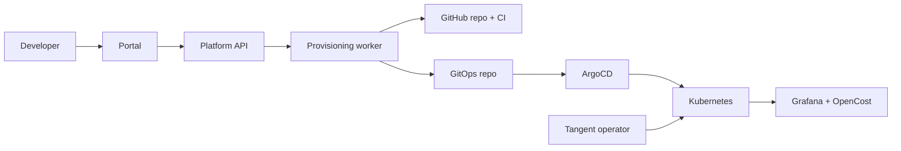

# Tangent

**A self-service Internal Developer Platform.**

A developer picks a template, names a service and chooses a team. Tangent creates the repository, CI pipeline, Kubernetes environment, GitOps deployment, dashboards and cost tracking. No tickets, no waiting on the platform team.

> **Status:** design phase. The full specification lives in [`docs/`](docs/README.md); implementation follows the [roadmap](docs/roadmap.md).

---

## What it does

- **One-click services:** go from idea to a running service in a dev environment in under 10 minutes.
- **Golden paths:** every service starts with logging, tracing, health checks, a Dockerfile, a Helm chart and CI already wired.
- **GitOps by default:** the platform never touches the cluster directly; it commits to Git and ArgoCD reconciles.
- **Tenant isolation:** a custom Kubernetes operator gives each team namespaces with quotas, RBAC and network policies.
- **Guardrails, not gates:** policies apply automatically; approvals are only needed for production.
- **Visibility:** auto-provisioned Grafana dashboards, per-team cost tracking and a full audit log.

## How it works



The developer's request is stored in Postgres, then a worker carries it out step by step: create the repo, push the template, commit manifests to the GitOps repo, and wait for ArgoCD to report the service healthy. Every step is idempotent and retryable, so a crash halfway through resumes safely. See [Architecture](docs/architecture.md) for the detailed flow.

## Built with

Go · PostgreSQL · Kubernetes (kubebuilder operator) · ArgoCD · GitHub Actions · Terraform · Keycloak · Kyverno · Vault · Prometheus, Grafana, Loki, Tempo · OpenCost · Next.js

Full list with reasoning: [Tech stack](docs/tech-stack.md).

## Quick start

```bash
git clone https://github.com/TheTangentLine/tangent && cd tangent
cp .env.example .env    # GitHub App ID, private key path, org
make cluster-up         # local kind cluster
make bootstrap          # ArgoCD and platform services
make dev                # API, worker, operator and portal with live reload
```

Then open <http://portal.localtest.me>. Details and prerequisites: [Local development](docs/local-development.md).

## Documentation

| | |
|---|---|
| [Overview](docs/overview.md) | Goals, concepts and roles |
| [Architecture](docs/architecture.md) | How the pieces fit together |
| [Component specs](docs/README.md#component-specs) | API, data model, provisioning engine, operator, templates, GitOps, CI, infra, security, observability, cost, portal |
| [Roadmap](docs/roadmap.md) | Milestones and "done when" criteria |
| [All docs](docs/README.md) | Full index |

## Roadmap at a glance

| Milestone | Outcome |
|---|---|
| M0 Foundations | Local cluster, ArgoCD, Keycloak, a template deployed by hand |
| M1 Operator | `TeamEnvironment` produces a fully configured namespace |
| M2 Platform API | Create a service via the API with auth, RBAC and audit |
| M3 Provisioning engine | One API call gives a repo, passing CI and a running pod |
| M4 Portal | Create a service by clicking through the UI |
| M5 Guardrails and insight | Prod approvals, policies, dashboards, team costs |
| M6 Hardening and demo | End-to-end tests and a public demo |

## License

MIT
