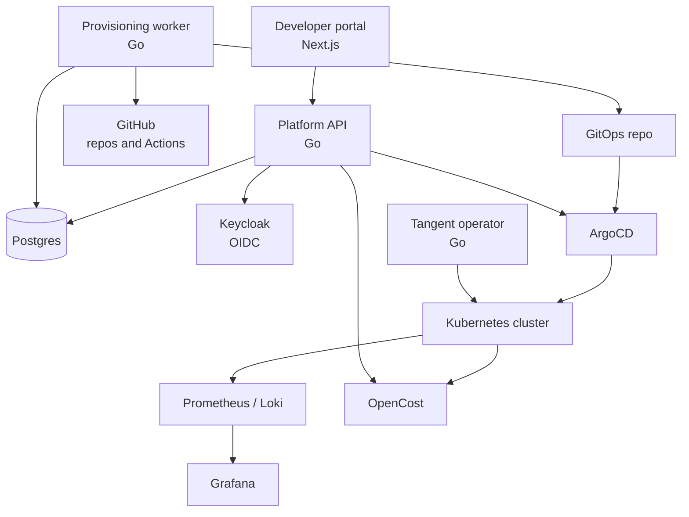
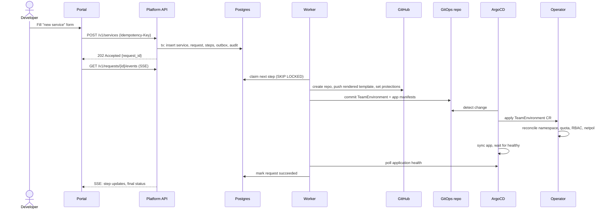

[← Docs index](README.md)

# Architecture

## Component overview

The **API** and the **worker** are the same Go binary started in two modes (`tangent api`, `tangent worker`). They share packages and the database, but scale independently.

## Lifecycle of "create service"

## Design principles

1. **Git is the write path.** All cluster state lives in the GitOps repo. The worker writes to Git; ArgoCD writes to the cluster. Rollback is `git revert`.
2. **Every step is idempotent.** Running a step twice must give the same result as running it once. Steps check current state before acting.
3. **Durable intent first, side effects second.** The API only writes to Postgres. External calls happen in the worker, driven by rows in the database.
4. **The operator owns tenant scaffolding.** Namespaces, quotas, RBAC and network policies are derived from one `TeamEnvironment` resource, never hand-written.
5. **Least privilege everywhere.** The worker's GitHub App, Kubernetes service account and database user each get only what they need.
