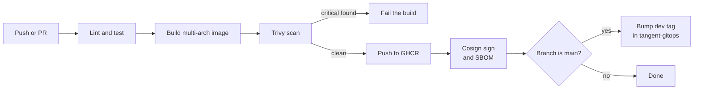

[← Docs index](../README.md)

# CI pipelines

A reusable workflow in this repo (`.github/workflows/service-ci.yaml`, `on: workflow_call`). Generated services call it:

```yaml
# in each generated service
jobs:
  ci:
    uses: <org>/tangent/.github/workflows/service-ci.yaml@v1
    with:
      service: payments-api
      team: payments
    permissions:
      contents: read
      packages: write
      id-token: write
```



Stages:

1. **Lint and test:** language-specific (detected from template).
2. **Build image:** Docker Buildx, multi-arch (`linux/amd64,linux/arm64`) so it runs on the ARM demo node.
3. **Scan:** Trivy, fail on `CRITICAL`.
4. **Push:** to `ghcr.io/<org>/<service>:<git-sha>`.
5. **Sign (optional):** cosign keyless signing with GitHub OIDC; Kyverno can verify signatures.
6. **Bump dev tag:** on `main` only, open (or auto-merge) a commit to `tangent-gitops` updating `apps/<team>/<service>/dev/values.yaml`. Use a GitHub App token scoped to the GitOps repo, not a personal token.
