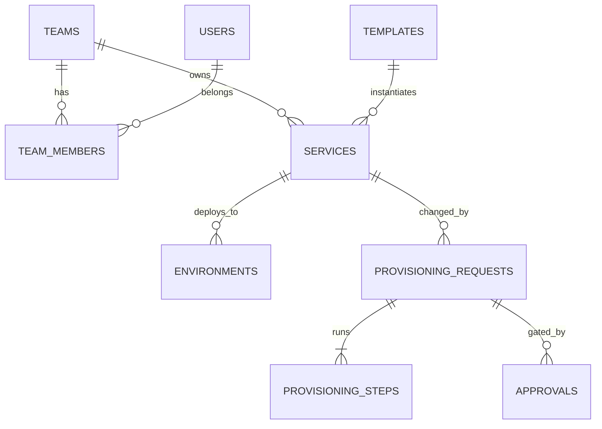

[← Docs index](../README.md)

# Data model

PostgreSQL. UUIDv7 primary keys (time-ordered). All timestamps are `timestamptz`.

```sql
CREATE TABLE users (
    id            uuid PRIMARY KEY,
    oidc_subject  text UNIQUE NOT NULL,
    email         text NOT NULL,
    display_name  text NOT NULL,
    is_platform_admin boolean NOT NULL DEFAULT false,
    created_at    timestamptz NOT NULL DEFAULT now()
);

CREATE TABLE teams (
    id            uuid PRIMARY KEY,
    slug          text UNIQUE NOT NULL CHECK (slug ~ '^[a-z][a-z0-9-]{1,30}$'),
    name          text NOT NULL,
    monthly_budget_cents bigint,
    created_at    timestamptz NOT NULL DEFAULT now()
);

CREATE TYPE team_role AS ENUM ('viewer', 'developer', 'team-lead');

CREATE TABLE team_members (
    team_id  uuid REFERENCES teams(id) ON DELETE CASCADE,
    user_id  uuid REFERENCES users(id) ON DELETE CASCADE,
    role     team_role NOT NULL,
    PRIMARY KEY (team_id, user_id)
);

CREATE TABLE templates (
    id          uuid PRIMARY KEY,
    name        text NOT NULL,
    version     text NOT NULL,          -- semver
    source_ref  text NOT NULL,          -- git ref or path in templates/
    params_schema jsonb NOT NULL,       -- JSON Schema for parameters
    deprecated  boolean NOT NULL DEFAULT false,
    UNIQUE (name, version)
);

CREATE TYPE service_status AS ENUM ('provisioning', 'active', 'failed', 'decommissioning', 'archived');

CREATE TABLE services (
    id           uuid PRIMARY KEY,
    name         text NOT NULL CHECK (name ~ '^[a-z][a-z0-9-]{1,40}$'),
    team_id      uuid NOT NULL REFERENCES teams(id),
    template_id  uuid NOT NULL REFERENCES templates(id),
    parameters   jsonb NOT NULL DEFAULT '{}',
    repo_url     text,
    status       service_status NOT NULL,
    created_by   uuid NOT NULL REFERENCES users(id),
    created_at   timestamptz NOT NULL DEFAULT now(),
    UNIQUE (name)
);

CREATE TYPE env_tier AS ENUM ('dev', 'staging', 'prod');

CREATE TABLE environments (
    id          uuid PRIMARY KEY,
    service_id  uuid NOT NULL REFERENCES services(id) ON DELETE CASCADE,
    tier        env_tier NOT NULL,
    namespace   text NOT NULL,          -- {team}-{tier}
    status      text NOT NULL,          -- pending | ready | degraded | deleted
    url         text,
    UNIQUE (service_id, tier)
);

CREATE TYPE request_kind   AS ENUM ('create_service', 'add_environment', 'decommission_service');
CREATE TYPE request_status AS ENUM ('pending', 'awaiting_approval', 'running', 'succeeded', 'failed', 'compensating', 'cancelled');

CREATE TABLE provisioning_requests (
    id          uuid PRIMARY KEY,
    kind        request_kind NOT NULL,
    service_id  uuid REFERENCES services(id),
    payload     jsonb NOT NULL,
    status      request_status NOT NULL,
    requested_by uuid NOT NULL REFERENCES users(id),
    created_at  timestamptz NOT NULL DEFAULT now(),
    finished_at timestamptz
);

CREATE TYPE step_status AS ENUM ('pending', 'running', 'succeeded', 'failed', 'skipped', 'compensated');

CREATE TABLE provisioning_steps (
    id           uuid PRIMARY KEY,
    request_id   uuid NOT NULL REFERENCES provisioning_requests(id) ON DELETE CASCADE,
    position     int  NOT NULL,
    name         text NOT NULL,
    status       step_status NOT NULL DEFAULT 'pending',
    attempts     int  NOT NULL DEFAULT 0,
    max_attempts int  NOT NULL DEFAULT 5,
    run_after    timestamptz NOT NULL DEFAULT now(),
    locked_by    text,
    locked_until timestamptz,
    output       jsonb,                 -- data passed to later steps
    last_error   text,
    started_at   timestamptz,
    finished_at  timestamptz,
    UNIQUE (request_id, position)
);
CREATE INDEX steps_ready_idx ON provisioning_steps (run_after) WHERE status = 'pending';

CREATE TABLE approvals (
    id          uuid PRIMARY KEY,
    request_id  uuid NOT NULL REFERENCES provisioning_requests(id) ON DELETE CASCADE,
    required_role text NOT NULL,        -- team-lead | platform-admin
    team_id     uuid REFERENCES teams(id),
    decision    text,                   -- approve | reject | null (pending)
    decided_by  uuid REFERENCES users(id),
    comment     text,
    decided_at  timestamptz
);

CREATE TABLE audit_events (
    id          bigserial PRIMARY KEY,
    occurred_at timestamptz NOT NULL DEFAULT now(),
    actor_id    uuid REFERENCES users(id),  -- null = system
    action      text NOT NULL,              -- e.g. service.create
    resource_type text NOT NULL,
    resource_id text NOT NULL,
    team_id     uuid REFERENCES teams(id),
    outcome     text NOT NULL,              -- success | denied | error
    metadata    jsonb NOT NULL DEFAULT '{}',
    request_ip  inet,
    trace_id    text
);
-- Append-only: the app's DB role has INSERT and SELECT only on this table.

CREATE TABLE idempotency_keys (
    key          text PRIMARY KEY,
    user_id      uuid NOT NULL REFERENCES users(id),
    request_hash text NOT NULL,
    response     jsonb NOT NULL,
    status_code  int NOT NULL,
    created_at   timestamptz NOT NULL DEFAULT now()
);
```

**Entity relationships**


