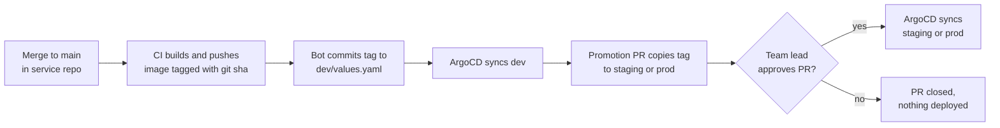

[← Docs index](../README.md)

# GitOps layer

## `tangent-gitops` repository layout

```text
tangent-gitops/
├── environments/                       # TeamEnvironment resources
│   ├── payments-dev.yaml
│   └── payments-prod.yaml
└── apps/
    └── payments/
        └── payments-api/
            ├── base/
            │   └── values.yaml
            ├── dev/
            │   ├── values.yaml         # image tag lives here
            │   └── config.json         # read by ApplicationSet
            └── prod/
                ├── values.yaml
                └── config.json
```

`config.json` example:

```json
{ "team": "payments", "service": "payments-api", "tier": "dev",
  "namespace": "payments-dev", "repoURL": "https://github.com/<org>/payments-api" }
```

## ApplicationSet

```yaml
apiVersion: argoproj.io/v1alpha1
kind: ApplicationSet
metadata:
  name: tenant-apps
  namespace: argocd
spec:
  goTemplate: true
  generators:
    - git:
        repoURL: https://github.com/<org>/tangent-gitops
        revision: main
        files:
          - path: "apps/*/*/*/config.json"
  template:
    metadata:
      name: "{{ .service }}-{{ .tier }}"
      labels:
        tangent.dev/team: "{{ .team }}"
    spec:
      project: tenants
      sources:
        - repoURL: "{{ .repoURL }}"
          targetRevision: main
          path: deploy/chart
          helm:
            valueFiles:
              - $values/apps/{{ .team }}/{{ .service }}/base/values.yaml
              - $values/apps/{{ .team }}/{{ .service }}/{{ .tier }}/values.yaml
        - repoURL: https://github.com/<org>/tangent-gitops
          targetRevision: main
          ref: values
      destination:
        server: https://kubernetes.default.svc
        namespace: "{{ .namespace }}"
      syncPolicy:
        automated: { prune: true, selfHeal: true }
```

A second Application (`tenant-environments`) syncs `environments/` so `TeamEnvironment` resources reach the operator. Use an ArgoCD sync wave so environments sync before apps.

**Promotion:** dev deploys automatically on merge to `main`. Promoting to staging or prod is a pull request in `tangent-gitops` that copies the image tag from `dev/values.yaml` to the target tier. For prod, CODEOWNERS requires the team lead.


