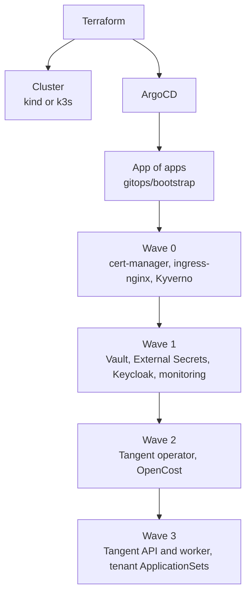

[← Docs index](../README.md)

# Infrastructure (Terraform)

```text
infra/terraform/
├── modules/
│   ├── k3s-node/          # VM + cloud-init installing k3s
│   ├── dns/               # records for portal, api, argocd, grafana
│   └── postgres/          # managed DB (optional; in-cluster for demo)
└── envs/
    ├── local/             # kind cluster via the kind provider
    └── demo/              # single ARM VM running k3s
```

- State backend: remote (for example an S3-compatible bucket) for `demo`; local for `local`.
- Terraform creates the cluster and installs **only** ArgoCD. Everything else (Keycloak, monitoring, Kyverno, Tangent itself) is installed by ArgoCD from `gitops/` in this repo using the app-of-apps pattern. This keeps Terraform thin and everything else declarative.
- Per-service cloud resources (a database or bucket) are a v2 feature: either Terraform run by the worker in a sandbox, or Crossplane. Record the decision in an ADR.

## Platform namespaces

| Namespace | Contents |
|---|---|
| `argocd` | ArgoCD |
| `tangent-system` | API, worker, operator, Postgres (demo) |
| `keycloak` | Keycloak |
| `monitoring` | Prometheus, Grafana, Loki, Tempo, OTel Collector |
| `kyverno` | Kyverno |
| `external-secrets`, `vault` | Secrets |
| `opencost` | OpenCost |
| `ingress-nginx`, `cert-manager` | Ingress and TLS |

## Bootstrap order

Terraform does the minimum; ArgoCD installs everything else in sync waves so dependencies come up first.


