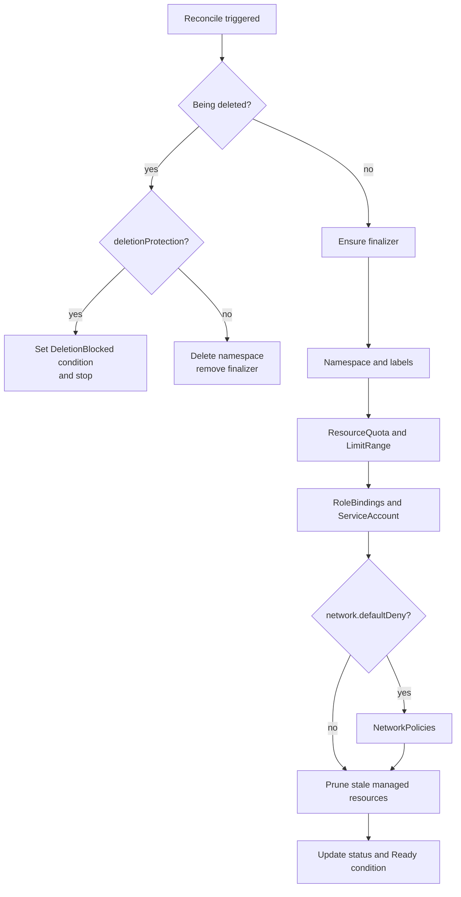

[← Docs index](../README.md)

# Kubernetes operator

A cluster-scoped custom resource, `TeamEnvironment`, describes one team's namespace for one tier. The operator turns it into concrete resources and keeps them in place (drift is corrected).

> Use an API group under a domain you control, for example `platform.<your-domain>`. These docs use `platform.tangent.dev` as a placeholder.

## Custom resource

```yaml
apiVersion: platform.tangent.dev/v1alpha1
kind: TeamEnvironment
metadata:
  name: payments-dev
spec:
  team: payments
  tier: dev                 # dev | staging | prod
  quota:
    cpu: "4"
    memory: 8Gi
    pods: 30
    persistentVolumeClaims: 5
  defaults:                 # LimitRange defaults per container
    cpuRequest: 100m
    memoryRequest: 128Mi
    cpuLimit: 500m
    memoryLimit: 512Mi
  access:
    - group: "tangent:team:payments:developer"
      role: edit
    - group: "tangent:team:payments:viewer"
      role: view
  network:
    defaultDeny: true
    allowIngressFromNamespaces: [ingress-nginx, monitoring]
    allowEgressToInternet: true
  deletionProtection: false # forced true for prod by a Kyverno policy
status:
  namespace: payments-dev
  observedGeneration: 3
  conditions:
    - type: Ready
      status: "True"
      reason: Reconciled
      lastTransitionTime: "2026-10-23T08:01:00Z"
```

## Go types (sketch)

```go
type TeamEnvironmentSpec struct {
    Team               string        `json:"team"`
    // +kubebuilder:validation:Enum=dev;staging;prod
    Tier               string        `json:"tier"`
    Quota              QuotaSpec     `json:"quota"`
    Defaults           DefaultsSpec  `json:"defaults,omitempty"`
    Access             []AccessGrant `json:"access,omitempty"`
    Network            NetworkSpec   `json:"network,omitempty"`
    DeletionProtection bool          `json:"deletionProtection,omitempty"`
}

type TeamEnvironmentStatus struct {
    Namespace          string             `json:"namespace,omitempty"`
    ObservedGeneration int64              `json:"observedGeneration,omitempty"`
    Conditions         []metav1.Condition `json:"conditions,omitempty"`
}
```

## Reconcile logic

```text
Reconcile(TeamEnvironment te):
  if te is being deleted:
      if te.spec.deletionProtection: set condition DeletionBlocked; return
      delete namespace (owned resources cascade); remove finalizer; return
  ensure finalizer present
  ns := "{team}-{tier}"
  CreateOrUpdate Namespace ns
      labels: tangent.dev/team, tangent.dev/tier, pod-security.kubernetes.io/enforce=restricted
  CreateOrUpdate ResourceQuota  "tangent-quota"
  CreateOrUpdate LimitRange     "tangent-defaults"
  for each access grant: CreateOrUpdate RoleBinding (group → ClusterRole edit/view)
  CreateOrUpdate ServiceAccount "deployer"
  if network.defaultDeny:
      CreateOrUpdate NetworkPolicy "default-deny"
      CreateOrUpdate NetworkPolicy "allow-same-namespace"
      CreateOrUpdate NetworkPolicy "allow-from-<ns>" for each allowed namespace
      CreateOrUpdate NetworkPolicy "allow-dns-egress"
  delete any resource labelled tangent.dev/managed-by=operator in ns that is no longer desired
  update status: namespace, observedGeneration, Ready condition
```

The same logic as a flowchart:



Implementation notes:

- Set the `TeamEnvironment` as the owner of every resource it creates (`controllerutil.SetControllerReference`) so the operator is triggered when someone edits or deletes them (`Owns(&corev1.Namespace{})`, etc.).
- Emit Kubernetes Events for create, update and blocked deletion.
- Expose `tangent_operator_reconcile_total{result}` and `tangent_operator_reconcile_duration_seconds` (controller-runtime provides most of this).
- Add a validating webhook later (or CEL validation rules in the CRD) to reject quotas above the tier maximum.
