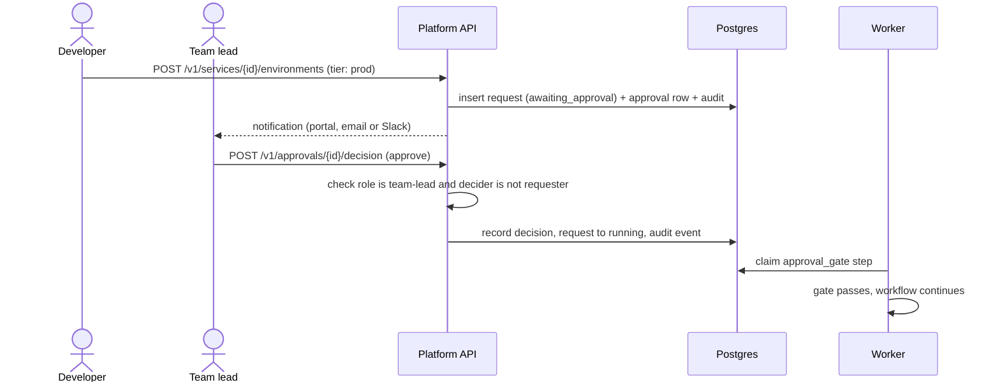

[← Docs index](../README.md)

# Platform API

**Responsibilities**

- Authenticate users (OIDC bearer tokens).
- Authorise actions (RBAC per team).
- Validate requests and persist intent (service, provisioning request, steps).
- Expose read models: catalogue, request status, costs, audit log.
- Stream request progress over Server-Sent Events.
- Record decisions on approvals.

It does **not** call GitHub or Kubernetes for write operations. That is the worker's job.

## Authentication

- The portal uses the OIDC Authorization Code flow with PKCE against Keycloak.
- The API verifies the JWT signature against Keycloak's JWKS (cached), checks `iss`, `aud`, `exp`.
- On first request, the user is upserted into `users` by the `sub` claim.
- Machine clients (the CLI, CI) use OIDC client credentials or short-lived personal access tokens stored hashed.

## Authorisation

Policy lives in one place, `internal/auth/policy.go`:

```go
type Action string

const (
    ActionServiceCreate     Action = "service:create"
    ActionEnvCreateNonProd  Action = "environment:create:nonprod"
    ActionEnvCreateProd     Action = "environment:create:prod"
    ActionApprovalDecide    Action = "approval:decide"
    ActionTeamManage        Action = "team:manage"
    ActionTemplateManage    Action = "template:manage"
)

// Authorize returns nil if the principal can perform the action on the team.
func (p *Policy) Authorize(ctx context.Context, who Principal, action Action, teamID uuid.UUID) error
```

| Action | viewer | developer | team-lead | platform-admin |
|---|---|---|---|---|
| Read services, requests, costs | ✓ | ✓ | ✓ | ✓ |
| `service:create` |  | ✓ | ✓ | ✓ |
| `environment:create:nonprod` |  | ✓ | ✓ | ✓ |
| `environment:create:prod` |  | request (needs approval) | request (needs approval) | ✓ |
| `approval:decide` (own team) |  |  | ✓ | ✓ |
| `team:manage` |  |  | ✓ | ✓ |
| `template:manage` |  |  |  | ✓ |

A user cannot approve their own request.

## Approval flow



## API endpoints (v1)

All responses are JSON. Errors use [RFC 9457 problem details](https://www.rfc-editor.org/rfc/rfc9457).

| Method | Path | Description |
|---|---|---|
| GET | `/healthz`, `/readyz` | Liveness and readiness |
| GET | `/v1/me` | Current user, teams and roles |
| GET | `/v1/teams` | Teams the user belongs to |
| POST | `/v1/teams` | Create team (platform-admin) |
| GET | `/v1/teams/{slug}` | Team detail |
| PUT | `/v1/teams/{slug}/members/{userId}` | Add or change member role |
| DELETE | `/v1/teams/{slug}/members/{userId}` | Remove member |
| GET | `/v1/templates` | List templates and versions |
| GET | `/v1/templates/{name}/versions/{version}` | Template parameters schema |
| GET | `/v1/services` | Catalogue (filter by team, template, status) |
| POST | `/v1/services` | Create service → returns `202` with `request_id` |
| GET | `/v1/services/{id}` | Service detail, environments, links |
| DELETE | `/v1/services/{id}` | Decommission (creates a provisioning request) |
| POST | `/v1/services/{id}/environments` | Add environment (prod requires approval) |
| GET | `/v1/requests/{id}` | Request with steps and status |
| GET | `/v1/requests/{id}/events` | SSE stream of step updates |
| POST | `/v1/requests/{id}/retry` | Retry a failed request from the failed step |
| POST | `/v1/requests/{id}/cancel` | Cancel and compensate |
| GET | `/v1/approvals?status=pending` | Approvals the user can decide |
| POST | `/v1/approvals/{id}/decision` | `{ "decision": "approve" \| "reject", "comment": "..." }` |
| GET | `/v1/teams/{slug}/costs?window=30d` | Cost breakdown by service and environment |
| GET | `/v1/audit` | Audit log (filter by actor, team, resource, time) |

Example: create a service.

```http
POST /v1/services
Authorization: Bearer <jwt>
Idempotency-Key: 6f1c2a3e-...
Content-Type: application/json

{
  "name": "payments-api",
  "team": "payments",
  "template": { "name": "go-http-api", "version": "1.2.0" },
  "parameters": { "port": 8080, "database": "postgres" },
  "environments": ["dev"]
}
```

```http
HTTP/1.1 202 Accepted
Location: /v1/requests/0b8e...

{ "service_id": "a12f...", "request_id": "0b8e...", "status": "pending" }
```

## Cross-cutting middleware

In order: request ID → structured logging (`slog`) → OpenTelemetry tracing → panic recovery → authentication → rate limiting (per user) → handler. Authorisation happens inside handlers, because it needs the target team.

**Idempotency:** mutating endpoints accept `Idempotency-Key`. The key and a hash of the request body are stored in `idempotency_keys` with the response. A repeat with the same key returns the stored response; same key with a different body returns `422`.

**Pagination:** cursor-based (`?limit=50&cursor=...`), cursor is an opaque base64 of `(created_at, id)`.
