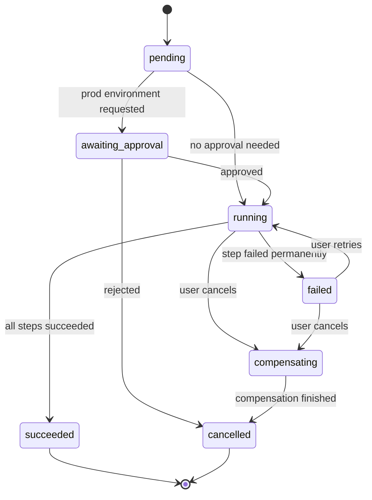
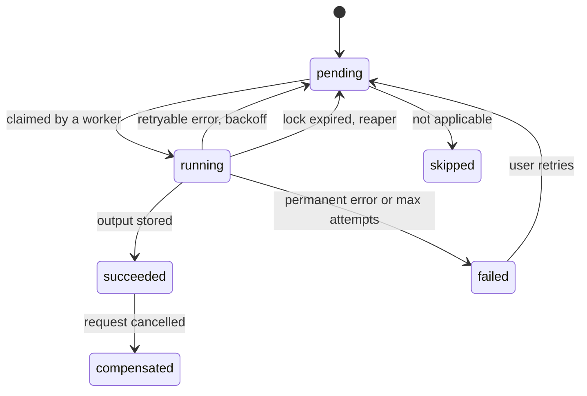

[← Docs index](../README.md)

# Provisioning engine

The engine executes **workflows**: ordered lists of **steps** persisted in `provisioning_steps`. It runs in `tangent worker` mode. Start with this Postgres-backed engine; migrating to Temporal later is an option recorded in an ADR.

## Step contract

```go
package provisioning

type RunContext struct {
    Request  domain.ProvisioningRequest
    Service  domain.Service
    Outputs  map[string]json.RawMessage // outputs of earlier steps, by step name
    Logger   *slog.Logger
}

type Result struct {
    Output any // persisted to provisioning_steps.output
}

type Step interface {
    Name() string
    // Execute must be idempotent: check current state, act only if needed.
    Execute(ctx context.Context, rc *RunContext) (Result, error)
    // Compensate undoes Execute. Must also be idempotent. May be a no-op.
    Compensate(ctx context.Context, rc *RunContext) error
}

// Errors are classified so the runner knows whether to retry.
var ErrPermanent = errors.New("permanent failure") // wrap with fmt.Errorf("...: %w", ErrPermanent)
```

## Workflow: `create_service`

| # | Step | What it does | Idempotency check | Compensation |
|---|---|---|---|---|
| 1 | `validate` | Re-validate name, quotas, template params | Pure function | none |
| 2 | `approval_gate` | If any env is prod, pause until approved | Approval row decided? | none |
| 3 | `create_repo` | Create GitHub repo under the org via GitHub App | Repo exists with `tangent` topic and matching service ID? | Archive repo (never delete) |
| 4 | `render_and_push_template` | Render template with params, initial commit | Default branch has commit with `Tangent-Service-ID` trailer? | none (repo archived) |
| 5 | `configure_repo` | Branch protection, CODEOWNERS, team access, topics | Compare desired vs actual | none |
| 6 | `write_gitops` | Commit `TeamEnvironment` (if new) and app manifests to `tangent-gitops` | Files exist with same content hash? | Revert commit |
| 7 | `register_dashboard` | Commit Grafana dashboard ConfigMap | File exists? | Remove file |
| 8 | `wait_for_sync` | Poll ArgoCD until app is `Synced` + `Healthy` (timeout 10 min) | Read-only | none |
| 9 | `finalize` | Set service `active`, environments `ready`, emit audit + notification | Status already active? | none |

## State machines

Provisioning request:



Provisioning step:



## Runner loop

```sql
-- Claim one ready step. Only the lowest pending position of a running request is eligible.
UPDATE provisioning_steps s
SET status = 'running', locked_by = $1, locked_until = now() + interval '5 minutes',
    attempts = attempts + 1, started_at = coalesce(started_at, now())
WHERE s.id = (
    SELECT s2.id FROM provisioning_steps s2
    JOIN provisioning_requests r ON r.id = s2.request_id
    WHERE s2.status = 'pending'
      AND s2.run_after <= now()
      AND r.status = 'running'
      AND NOT EXISTS (
          SELECT 1 FROM provisioning_steps p
          WHERE p.request_id = s2.request_id AND p.position < s2.position
            AND p.status NOT IN ('succeeded', 'skipped'))
    ORDER BY s2.run_after
    FOR UPDATE SKIP LOCKED
    LIMIT 1)
RETURNING *;
```

Rules:

- **Success:** store output, mark `succeeded`, notify listeners (`NOTIFY request_updates, '<request_id>'`).
- **Retryable error:** set `pending`, `run_after = now() + backoff(attempts)` (exponential with jitter, capped at 2 minutes).
- **Permanent error or attempts exhausted:** mark step `failed`, request `failed`. A user can `retry` (resets the failed step) or `cancel` (runs compensation in reverse order over succeeded steps, request becomes `compensating` then `cancelled`).
- **Crashed worker:** a reaper resets steps where `status = 'running' AND locked_until < now()` back to `pending`.
- **Heartbeat:** long steps (like `wait_for_sync`) extend `locked_until` periodically.

## Real-time updates

The API `LISTEN`s on the `request_updates` channel and fans events out to SSE subscribers for that request. Events:

```json
{ "type": "step.updated", "step": "create_repo", "status": "succeeded", "at": "2026-10-23T08:01:02Z" }
```
