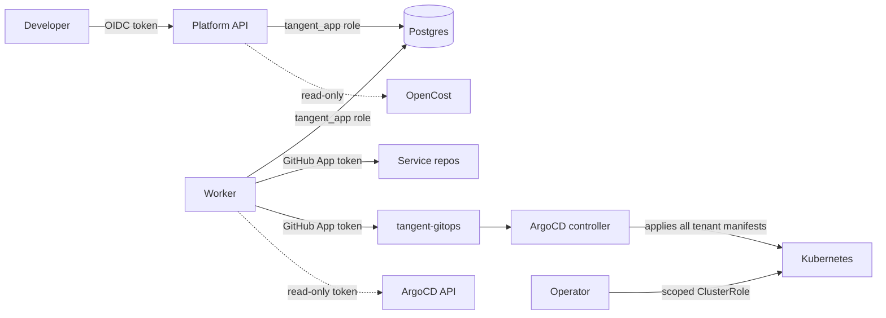

[← Docs index](../README.md)

# Security and policy

**Identity and access**

- GitHub access through a **GitHub App** installed on the org, with permissions: Administration (write, for repo creation), Contents (write), Metadata (read), Workflows (write). Tokens are short-lived installation tokens.
- The worker's Kubernetes service account has **read-only** access to ArgoCD Applications. It never writes to the cluster.
- The operator's ClusterRole is limited to the resource kinds it manages.
- Postgres roles: `tangent_app` (no DDL, insert/select only on `audit_events`), `tangent_migrate` (DDL, used only by the migration job).

**Who can write where**

Every arrow is a credential with the narrowest scope that works. Dashed means read-only.

**Kyverno policies** (in `gitops/platform/kyverno-policies/`)

| Policy | Mode |
|---|---|
| Require resource requests and limits | Enforce |
| Disallow `:latest` image tags | Enforce |
| Only allow images from `ghcr.io/<org>/` | Enforce |
| Require `tangent.dev/team` label on workloads | Enforce |
| Disallow privileged containers, host paths, host network | Enforce (also covered by Pod Security `restricted`) |
| Force `deletionProtection: true` on prod `TeamEnvironment` | Mutate |
| Verify cosign signatures | Audit first, then Enforce |

**Secrets**

- No secrets in Git, ever. Services declare `ExternalSecret` resources that reference Vault paths `secret/teams/<team>/<service>/<tier>/*`.
- Vault policies scope each team to its own path.

**Supply chain**

- Dependabot or Renovate on this repo and on templates.
- Trivy scanning in CI, image signing with cosign, SBOM generation (`syft`) attached to images.
