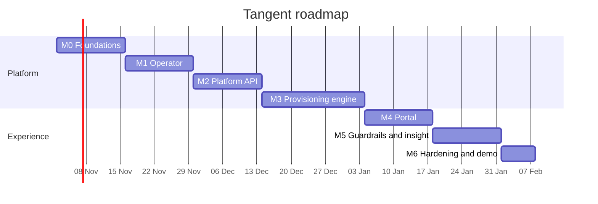

[← Docs index](README.md)

# Roadmap

Each milestone ends with something demoable. Dates assume a start on 2 November 2026; shift them to suit.

## M0: Foundations (weeks 1–2)

- [ ] Monorepo scaffold, Makefile, linting, CI for this repo
- [ ] kind cluster + ArgoCD + app-of-apps bootstrap
- [ ] Keycloak with seeded realm, users and groups
- [ ] One template (`go-http-api`) deployed to a namespace **by hand** through ArgoCD

**Done when:** `make cluster-up bootstrap` gives a working ArgoCD and a hand-deployed sample app.

## M1: Operator (weeks 3–4)

- [ ] `TeamEnvironment` CRD and types
- [ ] Reconcile namespace, quota, LimitRange, RoleBindings, NetworkPolicies
- [ ] Finalizer and deletion protection
- [ ] envtest suite
- [ ] Operator synced by ArgoCD from `tangent-gitops/environments/`

**Done when:** committing a `TeamEnvironment` YAML produces a fully configured namespace, and manual edits are reverted.

## M2: Platform API (weeks 5–6)

- [ ] Migrations and sqlc queries for the full data model
- [ ] OIDC authentication and RBAC policy with tests
- [ ] Teams, templates, services (create returns `202`), requests endpoints
- [ ] Audit log and idempotency keys
- [ ] OpenAPI spec

**Done when:** you can create a service via `curl` and see a pending request with steps in the database.

## M3: Provisioning engine (weeks 7–9)

- [ ] Runner with `SKIP LOCKED`, backoff, reaper, heartbeats
- [ ] GitHub App integration and `create_repo`, `render_and_push_template`, `configure_repo`
- [ ] `write_gitops`, `wait_for_sync`, `finalize`
- [ ] Retry and cancel with compensation
- [ ] SSE progress stream

**Done when:** one API call results in a new repo, a passing CI run, and a healthy pod in `team-dev`, end to end, with no manual steps.

## M4: Portal (weeks 10–11)

- [ ] Login, home, catalogue
- [ ] Service wizard with JSON-Schema-driven form
- [ ] Live request timeline
- [ ] Service detail page with links

**Done when:** a non-technical person can create a service by clicking through the UI.

## M5: Guardrails and insight (weeks 12–13)

- [ ] Kyverno policy set
- [ ] Prod environments with approval workflow
- [ ] Auto-provisioned Grafana dashboards and platform alerts
- [ ] OpenCost integration and team cost page
- [ ] External Secrets + Vault

**Done when:** a prod request waits for a team lead's approval, and team costs show in the portal.

## M6: Hardening and demo (week 14+)

- [ ] End-to-end test in CI on kind
- [ ] Chaos test: kill worker mid-request
- [ ] Terraform for the public ARM demo, TLS, DNS
- [ ] Recorded demo video and architecture write-up
- [ ] ADRs complete

## Later

- `tangent` CLI (`tangent create service`, `tangent status`)
- Template upgrade PRs for existing services
- Per-service cloud resources via Crossplane
- Ephemeral preview environments per pull request
- Scorecards (does the service have alerts, an owner, recent deploys?)
- Multi-cluster support
